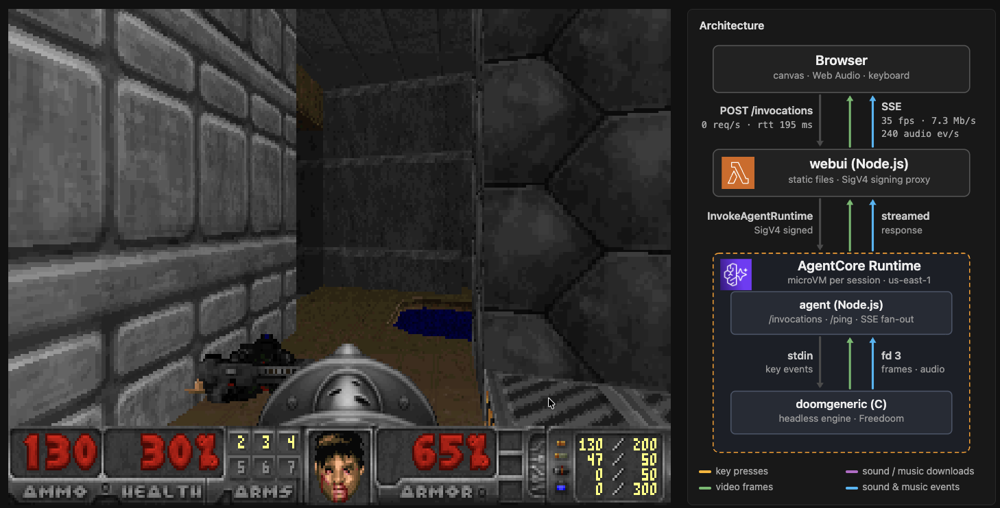

# Can it run DOOM: AWS Bedrock AgentCore

This is an experiment of running Doom on [Amazon Bedrock AgentCore Runtime](https://docs.aws.amazon.com/bedrock-agentcore/latest/devguide/runtime-how-it-works.html), played in a web browser.



> IMPORTANT: This project does not implement authentication. Anyone with your web UI URL can play, and you pay for the AWS resources they use. Be careful who you share it with and run `make destroy` to clean up after you're done playing. 

The game engine runs in an AgentCore Runtime v2. The browser draws the frames it receives, plays the sounds, and sends key presses back. There are no WebSockets: the server streams to the browser with Server-Sent Events (SSE), and the browser sends input as plain POST requests, hence expect minor lags. 

## How it works

- **Browser** (`webui/public`): draws frames on a canvas, plays sound effects and music with Web Audio, and sends key presses.
- **webui** (`webui/server.js`): serves the page and proxies every request to AgentCore Runtime, signing it with SigV4. It runs on AWS Lambda Web Functions.
- **AgentCore Runtime** (`doom/`): an ARM64 container on platform version V2, so new sessions start from a snapshot. Inside it:
  - **agent** (`doom/agent`): a Node.js server that implements `/invocations` and `/ping`. It turns engine output into SSE events and key presses into engine input.
  - **doomgeneric** (`doom/engine`): a headless build of [doomgeneric](https://github.com/ozkl/doomgeneric) playing [Freedoom](https://freedoom.github.io/). It writes frames and sound/music events to the agent and reads keys from it.

Every request is a `POST /invocations` whose JSON `type` says what it is:

| Type | What it does |
| --- | --- |
| `stream` | Opens a long-lived SSE stream of frames (320×200 WebP) plus sound and music events. |
| `input` | Sends key presses. |
| `sounds`, `music` | Download the sound effect samples (cached in the browser) and the music tracks. Music is pre-rendered to MP3 when the image is built. |

The arrows in the diagram light up live in the UI as traffic flows.

## Run it

**Locally (Docker):**

```sh
make local    # builds the image, runs it on :8080, serves the UI on http://localhost:3000
```

**On AWS (Terraform, `terraform/`):** this builds and pushes the image to ECR, then creates the AgentCore Runtime and the webui web function.

```sh
make deploy   # npm ci + terraform init/apply
```

See `webui_url` output.

To run the web UI locally against the deployed runtime (requests are signed with your local AWS credentials):

```sh
make webui-run-acr   # http://localhost:3000
```

Once done playing, destroy the resources. 

```sh
make destroy  # removes everything again
```

**Controls:** WASD move and turn · K fire · L open/use · Shift run · Esc menu (use the arrows and Enter in menus).

## Limits worth knowing

- AgentCore ends a streamed response after about 100 MB, which is a few minutes of gameplay (frames are ~6–8 Mbit/s while moving). The browser reconnects on its own and the game keeps running.
- This is an experiment. Sessions are configured to end 2 minutes after the last stream closes, and after 5 minutes at most (`terraform/ac_runtime_doom.tf`).

## Credits

- [doomgeneric](https://github.com/ozkl/doomgeneric) (GPL-2.0)
- [Freedoom](https://freedoom.github.io/) (BSD-3-Clause)
- music rendered with FluidSynth and the FluidR3 GM soundfont.

## License

The code in this repository is MIT-licensed (see [LICENSE](LICENSE)). The container image is not: the engine binary is built from [doomgeneric](https://github.com/ozkl/doomgeneric), so it is GPL-2.0. The image also bundles Freedoom game data (BSD-3-Clause) and music rendered with the FluidR3 GM soundfont. Third-party logos and names belong to their owners.
